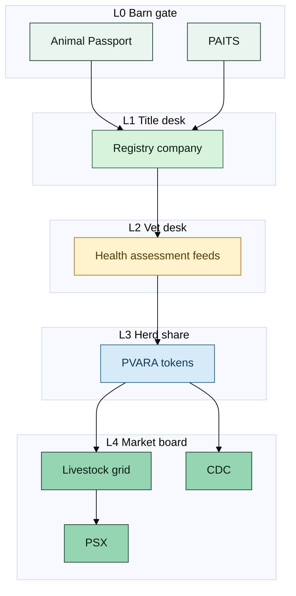

# Executive summary


**One-line claim:** Pakistan already has farm-gate digital identity — what is missing is a **barn-to-board stack** that turns it into bankable, attestable, market-visible assets.


## The smart process (SLAS)

**SLAS — Smart Livestock Asset Stack** — five farm-to-market layers:

| Layer | Farm metaphor | Job |
| --- | --- | --- |
| **L0** Field | Ear tag / muzzle scan | Animal Passport; PAITS |
| **L1** Registry | Title desk | Legal system of record; CDC sub (phased) |
| **L2** Health | Vet desk | Certified daily grades |
| **L3** Token | Herd / flock share | PVARA-aligned mint |
| **L4** Grid | Market board | Daily value feeds → PSX / CDC |

## Why this is novel


Apps, traceability pilots, exchanges, and virtual-asset talk already exist. **Novelty = wiring them into one farm-to-market process.**


## What success looks like

- Verified animal **promoted** into a registry title
- Title carries a **vet-desk health grade** on a defined clock
- Only passing stock underpins a **PVARA-compliant token**
- A **daily value board** publishes prices with verified-inventory %
- Banks/insurers price credit and cover off the stack — not notebooks


Not a product pitch, buy/sell call, or claim that named institutions have signed on.

