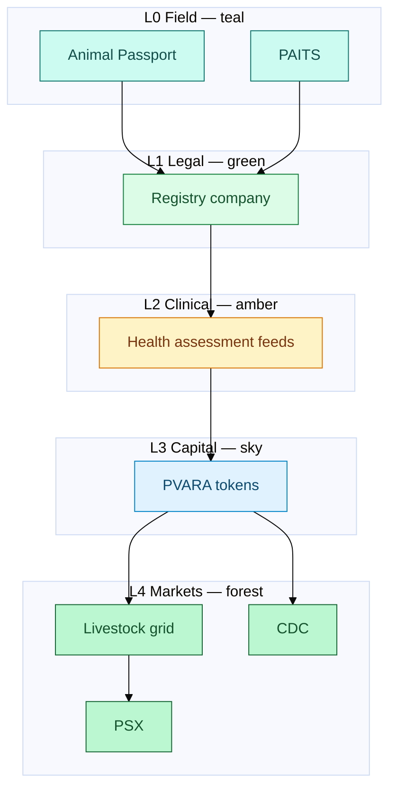

# Executive summary


**The claim in one line:** Field identity already works in Pakistan — what is missing is a **smart stack** that promotes it into registry, health, tokens, and a market grid.


## The smart process (SLAS)

**SLAS — Smart Livestock Asset Stack** — five layers:

| Layer | Job | Example rails |
| --- | --- | --- |
| **L0** Field capture | Bind animal ↔ owner | Animal Passport; PAITS |
| **L1** Registry company | Legal system of record | Purpose-built company; CDC sub (phased) |
| **L2** Health feeds | Certified risk signals | Vet/lab protocols; AKUH path; MoH / livestock |
| **L3** Tokenization | Transferable claims | PVARA-aligned rules |
| **L4** Market grid | Daily value + visibility | PSX info/listing; CDC custody |

## Why this is novel


Pieces exist in isolation. **The novelty is vertical integration** — identity good enough after a flood must also be good enough for an insurer, a token issuer, and a custody rail.


## What success looks like

- Biometrically verified animal **promoted** into a registry company record
- Record carries a **health grade** on a defined cadence
- Only passing animals/batches underpin a **PVARA-compliant token**
- A **daily value feed** publishes prices with verified-inventory %
- Banks/insurers price credit and cover off the stack — not notebooks


**Not** a product pitch, buy/sell recommendation, or claim that named institutions have agreed to participate.

