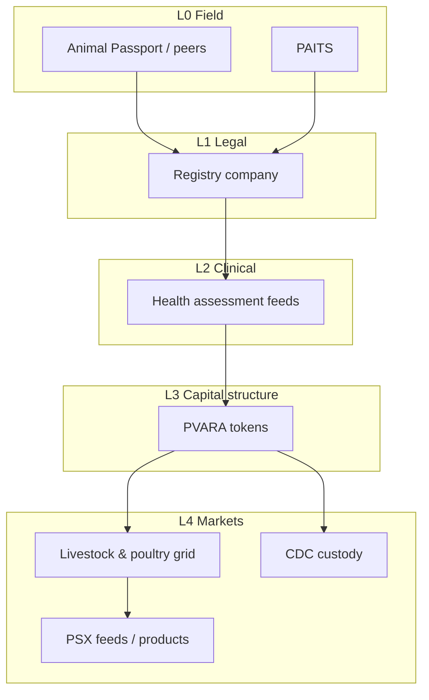

# Executive summary

## The claim

Pakistan’s livestock and poultry wealth is **economically huge but financially opaque**: ownership is hard to prove after shocks, health risk is rarely portable, and living animals almost never become **exchange-grade** or **custody-ready** assets. Field platforms already show that **digital animal identity** is possible. What does not yet exist — and what this independent paper proposes — is a **smart stack** that promotes that identity into legal registry, certified health feeds, regulated tokenization, and a national value grid.

## The smart process (SLAS)

**SLAS — Smart Livestock Asset Stack** — is a five-layer process:

| Layer | Job | Example rails (proposed / existing) |
| --- | --- | --- |
| L0 Field capture | Bind animal ↔ owner in the field | Animal Passport; PAITS |
| L1 Registry company | Legal system of record + controlled access | Purpose-built company; CDC sub (phased) |
| L2 Health feeds | Daily / periodic certified risk signals | Vet + lab protocols; AKUH standards path; MoH / livestock ministries |
| L3 Tokenization | Fractional / transferable economic claims | PVARA-aligned issuance rules |
| L4 Market grid | Daily value feeds + capital visibility | PSX information or listing products; CDC custody when ready |

## Why this is novel

Pieces exist in isolation (apps, traceability pilots, exchanges, virtual-asset policy talk). **The novelty is vertical integration**: identity that is good enough for a farmer after a flood must also be good enough for an insurer, a token issuer, and eventually a clearing/custody rail. No public Pakistan whitepaper yet treats that as one **smart process**.

## What success looks like

- A tagged / biometrically verified animal can be **promoted** into a registry company record.
- That record can carry a **health grade** that updates on a defined cadence.
- Only passing animals/batches can underpin a **PVARA-compliant token**.
- A **daily value feed** publishes regional / instrument prices conditioned on verified inventory.
- Banks and insurers price credit and cover off the stack — not off paper notebooks.

## What this paper is not

- Not a product pitch for any single vendor.
- Not a buy/sell recommendation for any security or token.
- Not a claim that named institutions have agreed to participate.
- Not affiliated with any employer, regulator, or exchange.

## Ask to the reader

Treat this as a **design blueprint**. Challenge the assumptions, pick a pilot province and species, and pressure-test the RACI in [How to achieve it](09-roadmap.md).
