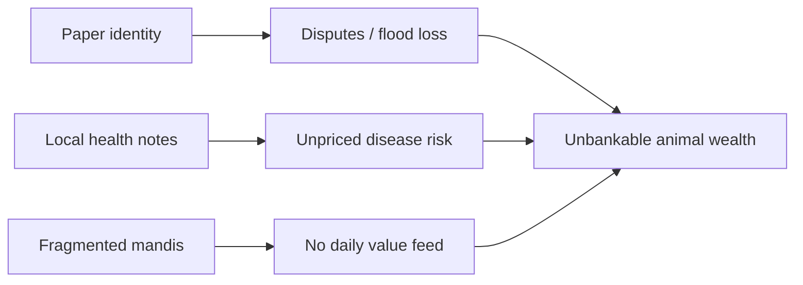

# The problem

## Three failures that keep animal wealth “off-book”

### 1. Identity fails when it matters most

Paper tags, notebooks, and informal village knowledge collapse under floods, theft disputes, and cross-district sales. When water rises, **proof of ownership disappears with the paper**. Digital biometric and national-traceability systems exist precisely because this pain is real — but they are not yet wired into capital markets.

### 2. Health risk is local and non-portable

A buyer, lender, or insurer rarely receives a **standardized, signed health feed** tied to a durable animal ID. Outbreak risk therefore stays informal. Without portable health grades, insurance pricing and token mint gates cannot be honest.

### 3. Price discovery is fragmented

Live animal and poultry value is discovered in mandis and farm-gate deals that do not produce a **national daily value surface**. Capital markets see equities and bonds; they do not see a clean livestock grid. Illiquidity is structural, not accidental.

## Why “just build an app” is not enough

An app can register a cow. A **smart asset stack** must also answer:

- Who is the **legal issuer of record**?
- Who may **query** the record (bank, insurer, exchange)?
- What **attestation** upgrades a farm note into a market-grade health feed?
- When may a **token** be minted or frozen?
- How does a **price** get published without misleading investors?

Those questions are market-infrastructure questions. This paper stays there.

## Design principle

> **Identity without custody is a database. Custody without identity is fiction. Price without both is noise.**

SLAS requires all three — plus health — before claiming that livestock is “on the grid.”
