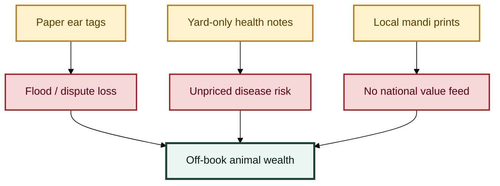

# The problem


**Broken fence:** animal wealth is huge on the farm — but **off-book** for banks, insurers, and markets.


## Three failures that keep animal wealth “off-book”


### 1. The ear tag washes away


Paper tags, notebooks, and village memory collapse under floods, theft disputes, and cross-district sales. When water rises, **proof of ownership disappears with the paper**. Biometric and national-traceability tools exist because this pain is real — but they are not yet wired into capital markets.


### 2. The vet note never leaves the yard


A buyer, lender, or insurer rarely gets a **standardized, signed health feed** tied to a durable animal ID. Outbreak risk stays informal. Without portable health grades, insurance pricing and token mint gates cannot be honest.


### 3. The mandi board never becomes a national board


Live animal and poultry value is discovered in mandis and farm-gate deals that do not produce a **national daily value surface**. Capital markets see equities and bonds — not a clean livestock grid. Illiquidity is structural, not accidental.

## Why “just build a farm app” is not enough


An app can register a cow. A **smart asset stack** must also answer title, access, attestation, mint, and price questions.


| Question the stack must answer | Farm metaphor | Layer |
| --- | --- | --- |
| Who is the **legal issuer of record**? | Title desk | Registry company |
| Who may **query** (bank, insurer, exchange)? | Who holds the keys | Access control |
| What upgrades a barn note into a market health feed? | Vet desk stamp | Health feeds |
| When may a **token** be minted or frozen? | Green lane / red pen | PVARA mint gate |
| How does a **price** get published safely? | Market board | Value grid |

## Design principle


**Identity without custody is a database.**\
**Custody without identity is fiction.**\
**Price without both is noise.**


SLAS requires identity + health + token + market rails before claiming livestock is “on the grid.”
