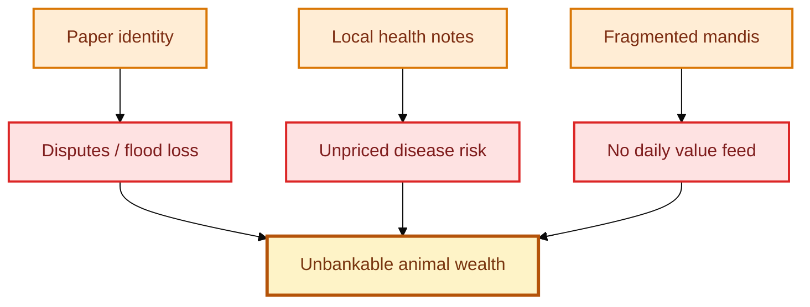

# The problem


**Core failure:** Pakistan’s animal wealth is economically huge but financially **off-book** — hard to prove, hard to insure, hard to price, hard to finance.


## Three failures that keep animal wealth “off-book”


### 1. Identity fails when it matters most


Paper tags, notebooks, and informal village knowledge collapse under floods, theft disputes, and cross-district sales. When water rises, **proof of ownership disappears with the paper**. Digital biometric and national-traceability systems exist precisely because this pain is real — but they are not yet wired into capital markets.


### 2. Health risk is local and non-portable


A buyer, lender, or insurer rarely receives a **standardized, signed health feed** tied to a durable animal ID. Outbreak risk therefore stays informal. Without portable health grades, insurance pricing and token mint gates cannot be honest.


### 3. Price discovery is fragmented


Live animal and poultry value is discovered in mandis and farm-gate deals that do not produce a **national daily value surface**. Capital markets see equities and bonds; they do not see a clean livestock grid. Illiquidity is structural, not accidental.

## Why “just build an app” is not enough


An app can register a cow. A **smart asset stack** must also answer market-infrastructure questions.


| Question the stack must answer | Layer |
| --- | --- |
| Who is the **legal issuer of record**? | Registry company |
| Who may **query** (bank, insurer, exchange)? | Access control |
| What **attestation** upgrades a farm note into a market-grade health feed? | Health feeds |
| When may a **token** be minted or frozen? | PVARA mint gate |
| How does a **price** get published without misleading investors? | Value grid |

## Design principle


**Identity without custody is a database.**\
**Custody without identity is fiction.**\
**Price without both is noise.**


SLAS requires identity + health + token + exchange rails before claiming that livestock is “on the grid.”
