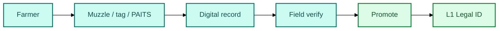

# Field identity: Animal Passport & PAITS


**Role:** L0 — capture and verification. Not the registry, not the exchange, not the token issuer. This is how living animals **enter** the smart process.


## Animal Passport — private product edge


Pakistan-rooted biometric livestock platform: muzzle/nose ID, owner binding, health/breeding history, APIs, flood-recovery identity.


| SLAS need | How it assists |
| --- | --- |
| Unique living asset | Biometric ID + optional tag |
| Owner binding | Owner account + contacts |
| Disaster continuity | Cloud ID survives lost tags |
| Integration | Verification API |
| Health raw events | Farm history → L2 inputs |

## PAITS — public policy edge


**PAITS** (PITB + FAO for GoP): national ID, tracing, health check, monitoring — **government data gravity**. Map private biometric IDs to PAITS keys (dual-rail).


## Integration models

| Model | Idea | Prefer when |
| --- | --- | --- |
| **A** Edge vendor | Apps onboard; registry is SoR | Fast multi-vendor pilot |
| **B** Dual-rail | PAITS + Animal Passport | Legitimacy + innovation |
| **C** Licensed operator | One capture agent / province | Deep MVP |
| **D** Standards-only | Any certified app | Open long-term market |


**v1 recommendation:** Model **B (dual-rail)** — one province, one species.



Do **not** claim Animal Passport or PAITS are already wired to PSX, CDC, PVARA, or AKUH without a signed MoU.

