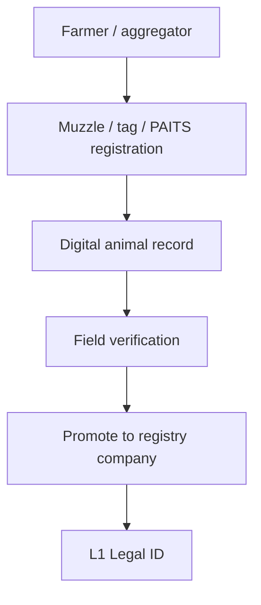

# Field identity: Animal Passport & PAITS

## Role in the stack

Field platforms are **L0 — capture and verification**. They are not the registry company, not the exchange, and not the token issuer. They are how living animals enter the smart process.

## Animal Passport (private / product edge)

[Animal Passport](https://www.animalpassport.co/) is a Pakistan-rooted livestock platform that emphasizes:

- AI **muzzle / nose biometric** identity (nose prints as animal “fingerprints”)
- Owner registration and animal verification
- Health, breeding, and ownership history
- Farm management tooling and **API** hooks for other systems
- Practical use in **flood recovery**, when paper records are gone

Public coverage has described free farmer access in Pakistan, founder-led flood registration drives, and reported registration volumes / test accuracy figures. Treat press numbers as **directional**, and re-verify with primary data before citing in a regulator briefing.

**How it assists SLAS**

| SLAS need | Assistance |
| --- | --- |
| Unique living asset | Biometric ID + optional tag number |
| Owner binding | Owner account + contact details |
| Continuity after disaster | Cloud identity survives lost tags/notebooks |
| Machine integration | Verification API for registry / insurers |
| Health raw events | Farm-side history and scoring as inputs to L2 |

## PAITS (public / policy edge)

The [Pakistan Animal Identification & Traceability System (PAITS)](https://pitb.gov.pk/node/9773) — developed by PITB with FAO for the Government of Pakistan — provides a **national livestock database** (web + mobile) for identification, registration, tracing, health check, and real-time monitoring.

**How it assists SLAS**

- Supplies **government data gravity** and traceability legitimacy
- Offers a public-sector path for provincial rollout
- Should be treated as a **mapping target** for private biometric IDs (dual-rail), not ignored

## Integration models (choose for the pilot)

| Model | Idea | Best when |
| --- | --- | --- |
| **A — Edge vendor** | Passport-class apps onboard; registry is system of record | Fast multi-vendor pilot |
| **B — Dual-rail** | PAITS = national backbone; Animal Passport = biometric UX / ops | Need legitimacy + innovation |
| **C — Licensed operator** | Registry licenses one capture agent per province/species | Deep MVP control |
| **D — Standards-only** | Any certified app may feed the grid | Long-term open market |

**Independent recommendation for v1:** start with **B (dual-rail)** in one province and one species — private biometric UX for farmers, PAITS keys for public traceability, registry company as legal promote target.

## Writing guardrail

Do **not** claim Animal Passport or PAITS are already connected to PSX, CDC, PVARA, or AKUH unless you hold a signed MoU. In this paper they are **proposed edge systems**.
