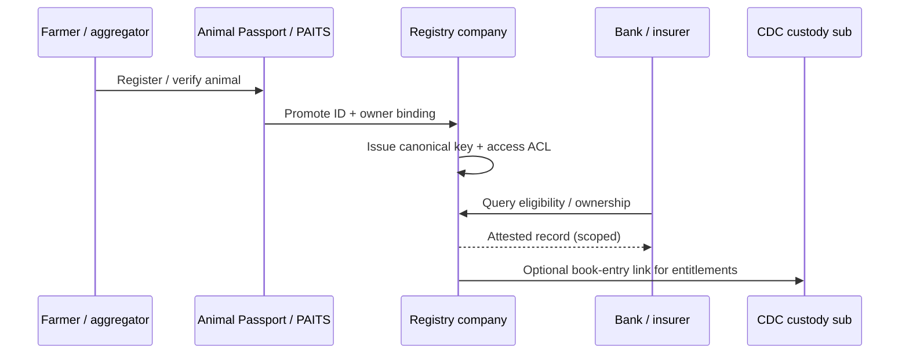

# Registry company


**L1 — Legal spine.** Your notes correctly struck “Access” and circled **company**. A query portal is not enough.


## Notebook origin

Pakistan needs a **registry company** — a legal person that issues and maintains animal / batch identities, governs who may read or write them, and can interface with custody (CDC sub) and health rails.

## Job of the registry

1. Accept **promoted** field IDs (Animal Passport / PAITS / peers)
2. Issue a **canonical registry key** (system of record)
3. Bind owner / aggregator KYC to that key
4. Expose **controlled APIs** to banks, insurers, token issuers, and (later) market data agents
5. Maintain dispute, re-tag, death, and transfer events

## Design choices to settle in the paper’s pilot

| Choice | Options | Lean for MVP |
| --- | --- | --- |
| Legal form | Section company / utility / concession | Narrow-purpose company with clear public-interest charter |
| ID source of truth | Field app vs registry | **Registry** wins; field apps are edges |
| Access model | Open vs licensed queriers | Licensed queriers (banks, insurers, issuers) |
| CDC link | Subsidiary vs special accounts | Phased: accounts first, sub later if volume justifies |
| Poultry vs cattle | Per-animal vs batch IDs | Cattle: per-head; poultry: **batch / flock** IDs |

## Must-have data fields (minimum)

- Canonical registry ID
- Field keys (passport biometric ref, PAITS ID, ear tag)
- Species / breed / sex / approx. age or DOB estimate
- Owner / aggregator identifiers (CNIC / NTN as applicable)
- Status: active · transferred · dead · quarantined · disputed
- Last health grade pointer (to L2 feed)
- Audit log hash / version

## Failure modes

- Double registration across apps → **merge rules** and biometric match thresholds
- Owner disputes → escrow + local verification workflow
- Ghost animals for credit → mandatory field re-verify before token mint or large loans
