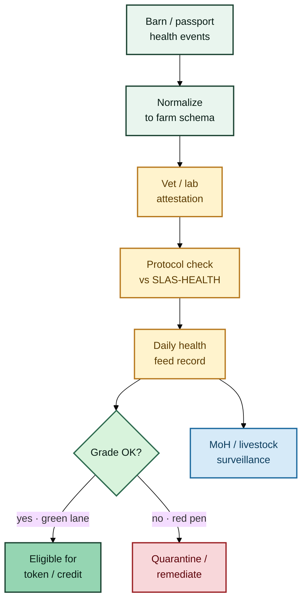

# Health assessment & daily feeds


**L2 — Farm health rail (amber / hay).** Barn notes and AI scores are the *raw feed*. Markets need a signed daily health grade — like an ear-tag that banks and token gates can read.


## Role in the stack

Think of this layer as the **vet desk between the paddock and the market**:

| Farm side (inputs) | Market side (outputs) |
| --- | --- |
| Passport / farm-app health events | Attested **daily health feed** |
| Local vet & lab notes | Grade **A / B / C / Quarantine** |
| Flock mortality & feed flags | Freeze / mint eligibility signals |

Proposed institutional path from the notebook: **clinical credibility** (e.g. AKUH standards path) plus **public-health policy** (Ministry of Health) with livestock / veterinary ministries. These are **design counterparts**, not claimed partners.




**Green lane** = grade passes → credit / token mint may proceed.\
**Red pen** = quarantine → freeze transfers until cleared.


## Two cadences (farm clock)

| Cadence | What the farm sees | What the market uses it for |
| --- | --- | --- |
| **Daily / near-daily** | Mortality, feed intake flags, flock alerts, movement | Outbreak alerts + token freeze |
| **Periodic** | Vaccination, lab panels, body condition, AI age/health scores | Insurance bands + mint eligibility |

## Feed record (ear-tag style stub)

```text
registry_id          # the animal / flock "tag"
timestamp_utc
metrics[]            # coded barn observations
attestor_id          # vet / lab / protocol agent
attestor_sig
protocol_version     # e.g. SLAS-HEALTH-0.1
grade                # A / B / C / Quarantine
validity_until
source_refs[]        # passport event IDs, lab report IDs
```

## Who does what on the farm vs in town

| Actor | On the farm / yard | Does **not** |
| --- | --- | --- |
| Animal Passport / farm apps | Capture raw signals & history | Issue market certificates alone |
| Local vets / labs | Attest what they see | Set national protocol alone |
| Standards partner (e.g. AKUH path) | Protocol, audit, training | Run every shed |
| MoH + livestock ministries | Outbreak / zoonoses rails | Replace farm capture |


**Why this layer matters:** a token that cannot be frozen when herd health collapses is a fiction sold to investors. L2 is the ethical core of the stack — the difference between a living asset and a paper cow.

