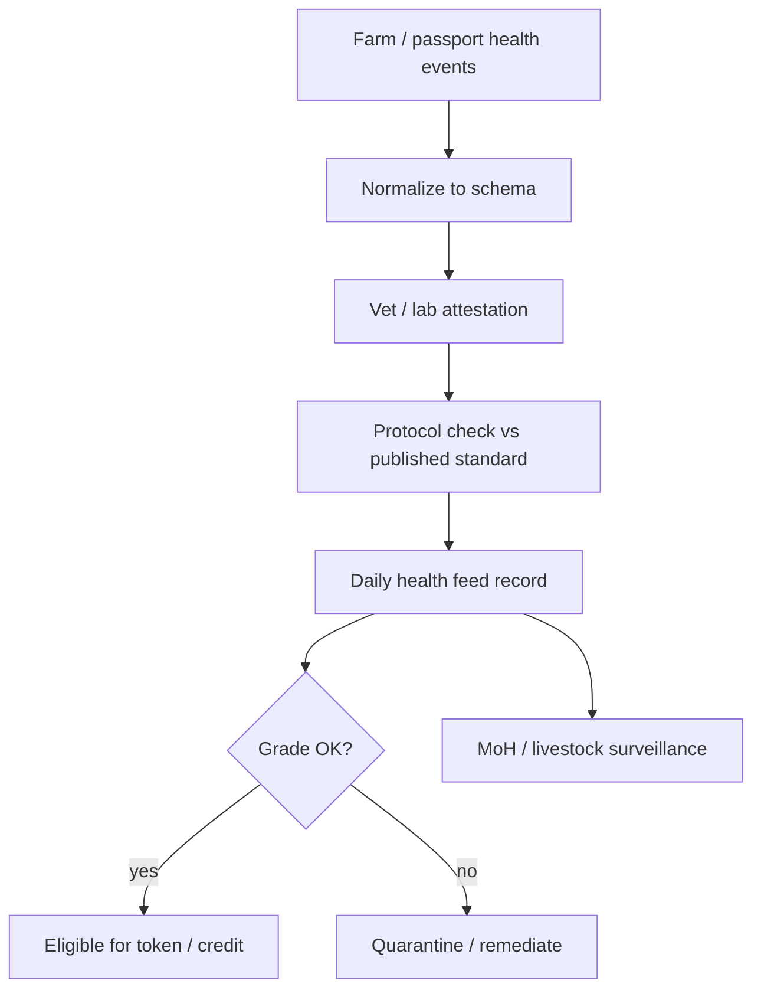

# Health assessment & daily feeds


**L2 — Amber layer.** Raw farm notes are inputs. Market-grade **daily health feeds** need attestation lenders and token gates can trust.


## Role in the stack

Health is **L2**. Raw farm notes (including AI scores from passport-class apps) are **inputs**. Market-grade **daily health feeds** require an attestation model that lenders and token gates can trust.

Proposed institutional path from the notebook: **clinical credibility** (e.g. AKUH standards / protocol partnership) plus **public-health policy** (Ministry of Health) coordinated with livestock / veterinary ministries. These are **design counterparts**, not claimed partners.



## Two cadences

| Cadence | Examples | Used for |
| --- | --- | --- |
| **Daily / near-daily** | Mortality, feed intake flags, flock alerts, movement | Outbreak + token freeze triggers |
| **Periodic** | Vaccination, lab panels, body condition, AI age/health scores | Grade bands for insurance & mint |

## Feed record (stub schema)

```text
registry_id
timestamp_utc
metrics[]          # coded observations
attestor_id        # vet / lab / protocol agent
attestor_sig
protocol_version   # e.g. SLAS-HEALTH-0.1
grade              # A / B / C / Quarantine
validity_until
source_refs[]      # passport event IDs, lab report IDs
```

## Division of labour

| Actor | Does | Does not |
| --- | --- | --- |
| Animal Passport / farm apps | Capture raw signals & history | Issue market-grade certificates alone |
| Local vets / labs | Attest observations | Set national protocol alone |
| Standards partner (e.g. AKUH path) | Protocol, audit, training | Necessarily operate every farm |
| MoH + livestock ministries | Outbreak policy, zoonoses rails | Replace farm capture |

## Why daily feeds matter for tokenization

A token that cannot be **frozen or downgraded** when health collapses is a fiction sold to investors. L2 is the ethical core of the smart process.
