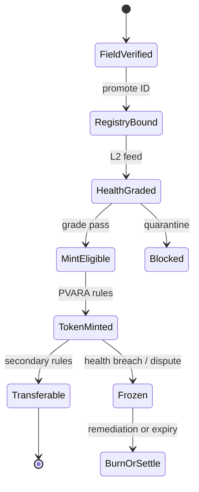

# PVARA tokenization


**L3 — Sky layer.** Tokens mint **only after** L1 identity + L2 health pass. Notebook: **PVARA → Livestock Tokenization & Poultry**.


## Role in the stack

Tokenization creates transferable economic claims on verified living assets or batches — **only after** L1 identity and L2 health pass.



## What the token can represent (pick explicitly)

| Object | Fits | Caution |
| --- | --- | --- |
| Single large animal economic claim | Breeding / fattening cattle | Welfare & delivery logistics |
| Flock / batch claim | Poultry cycles | Batch ID discipline |
| Pooled herd share | Diversified risk | NAV methodology |
| Cashflow claim (milk / eggs) | Shorter tenor products | Oracle dependence |

## Mint gate (non-negotiable)

```text
MAY_MINT =
  registry.status == active
  AND health.grade in {A, B}
  AND health.validity_until > now
  AND no open dispute
  AND not already pledged beyond limit
```

## Custody path

- **Phase 1:** issuer register + off-exchange transfer rules  
- **Phase 2:** **CDC** book-entry entitlements (notebook: CDC sub)  
- **Phase 3:** optional PSX-visible products once liquidity and disclosure mature  

## Compliance posture (independent framing)

This paper does **not** assert a final legal classification. The design assumes issuers will seek clarity under Pakistan’s evolving virtual-asset / securities perimeter (**PVARA** and related authorities). Shariah review should be treated as a first-class workstream for farmer and retail acceptance.

## Anti-abuse

- Biometric / PAITS re-verify before large mints
- One registry ID → controlled pledge graph (no silent double-count)
- Automatic freeze hooks from L2 quarantine flags
