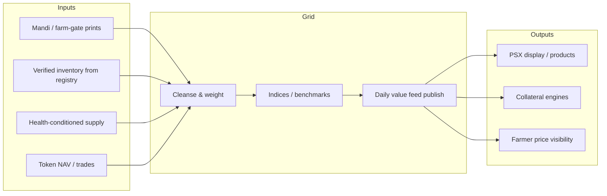

# Livestock & poultry grid


**L4 — Forest layer.** National aggregation into **daily value feeds**. Notebook: Grid → daily value feeds → PSX (+ CDC, phased).


## Role in the stack

The grid turns fragmented farm-gate and mandi observations into **daily value feeds**. Listing and custody stay separable.



## Product ladder (do not jump to listing day one)

| Stage | Product | PSX role | CDC role |
| --- | --- | --- | --- |
| 0 | Private benchmark (pilot region) | None | None |
| 1 | **Information product** — daily published feed | Display / data partnership | Optional |
| 2 | Index / total-return style benchmarks | Branding / methodology review | None / light |
| 3 | Listed or admitted products | Market venue | Custody for entitlements |

Notebook strike on “CDC” next to PSX is useful: treat **listing** and **custody** as separable. Publish prices before you clear tokens.

## Daily value feed stub

```text
instrument_code
region
unit
price
currency
methodology_version
sources[]
pct_verified_inventory
publish_time_pk
```

## Integrity rule

A grid that ignores verification percentage will be gamed. Publish **`pct_verified_inventory`** beside every headline price so users see how much of the print sits on passport/registry-backed stock.
