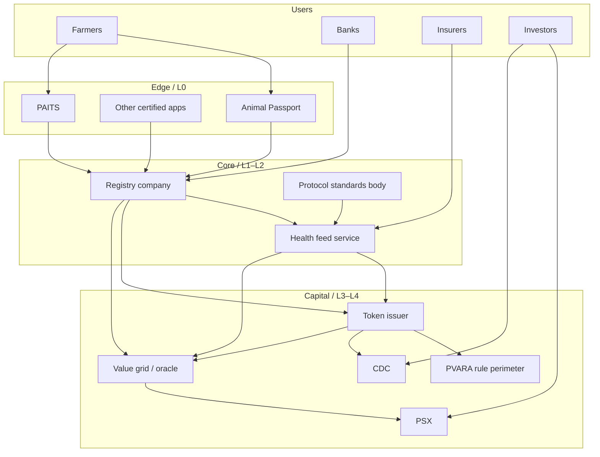
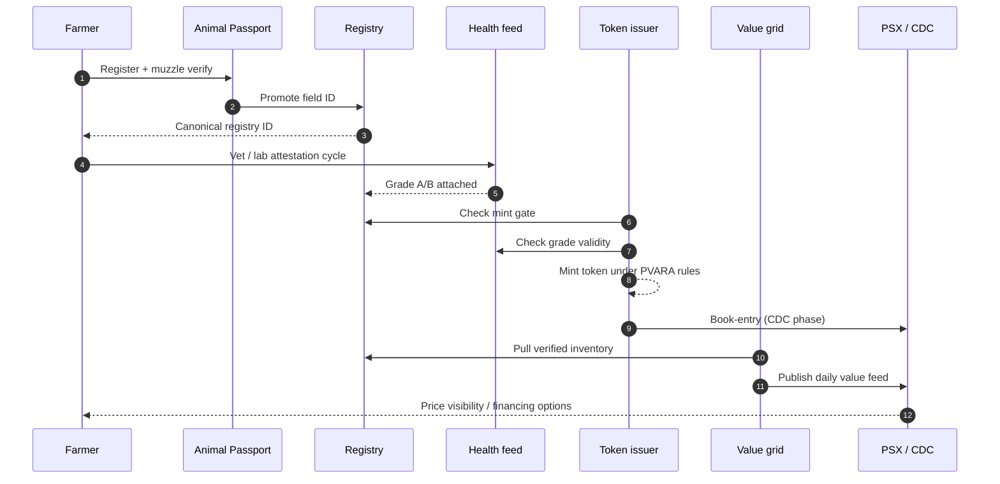
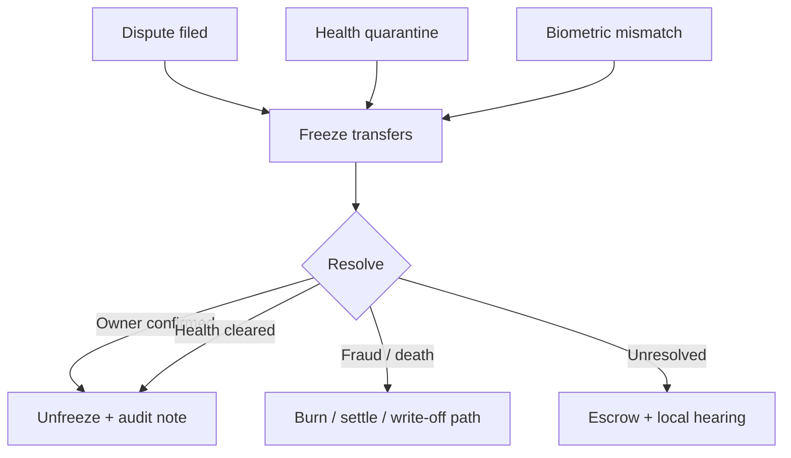

# End-to-end architecture & flows

## Layer map



## Happy path: cow (or flock) becomes a priced, custody-ready claim



## Control flow: when something goes wrong



## Achievement checklist (architecture readiness)

| Capability | Ready when… |
| --- | --- |
| Capture | ≥1 certified edge app writing promotes |
| Legal ID | Registry company live with ACL + audit log |
| Health | Protocol v0.1 published; ≥1 attestor network |
| Token | Mint gate enforced in code + legal docs |
| Grid | Daily feed auto-publishes with methodology note |
| Market | At least Stage-1 PSX information product **or** private benchmark with bank consumers |

## Reference deployment topology (logical)

```text
[Mobile edge] → [Promote API] → [Registry service]
                                      ↓
                              [Health feed service] ← [Attestor portal]
                                      ↓
                              [Issuer / token service] → [CDC adapter]
                                      ↓
                              [Grid publisher] → [PSX data channel]
                                      ↓
                              [Bank / insurer query API]
```

All components can start as separate services behind a single pilot operator; they should remain **logically separable** so no vendor lock-in collapses the stack.
