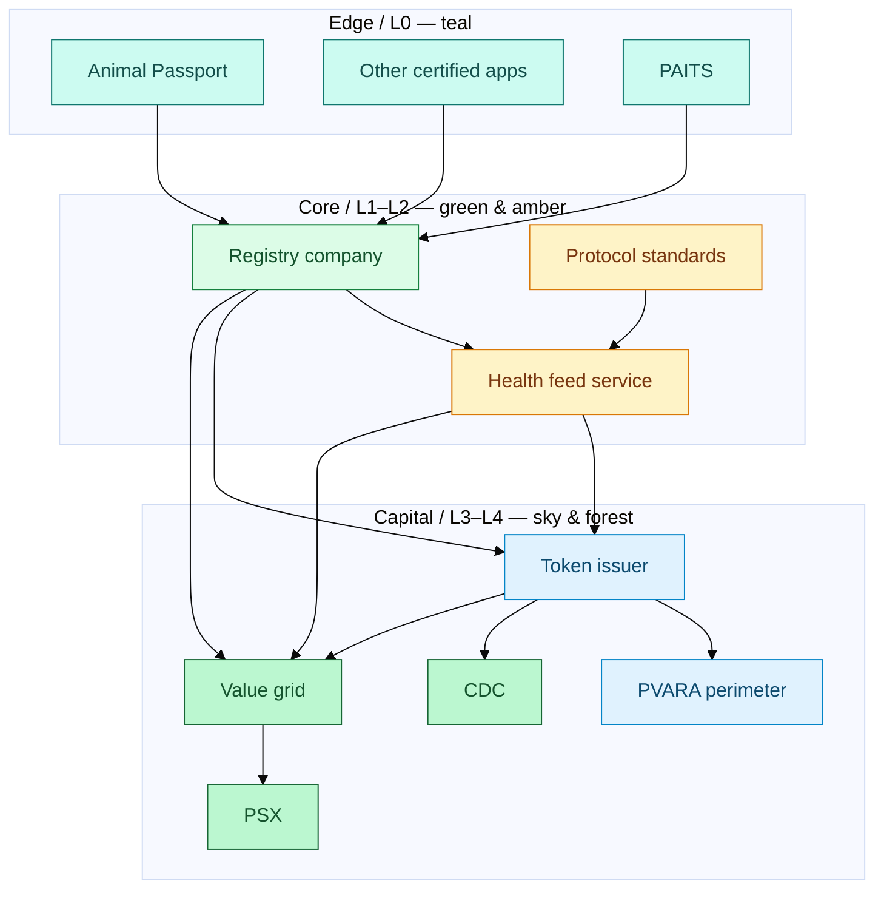
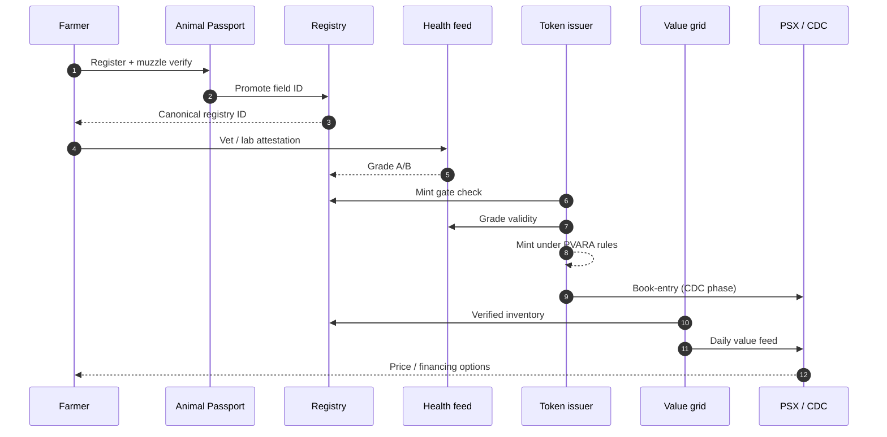
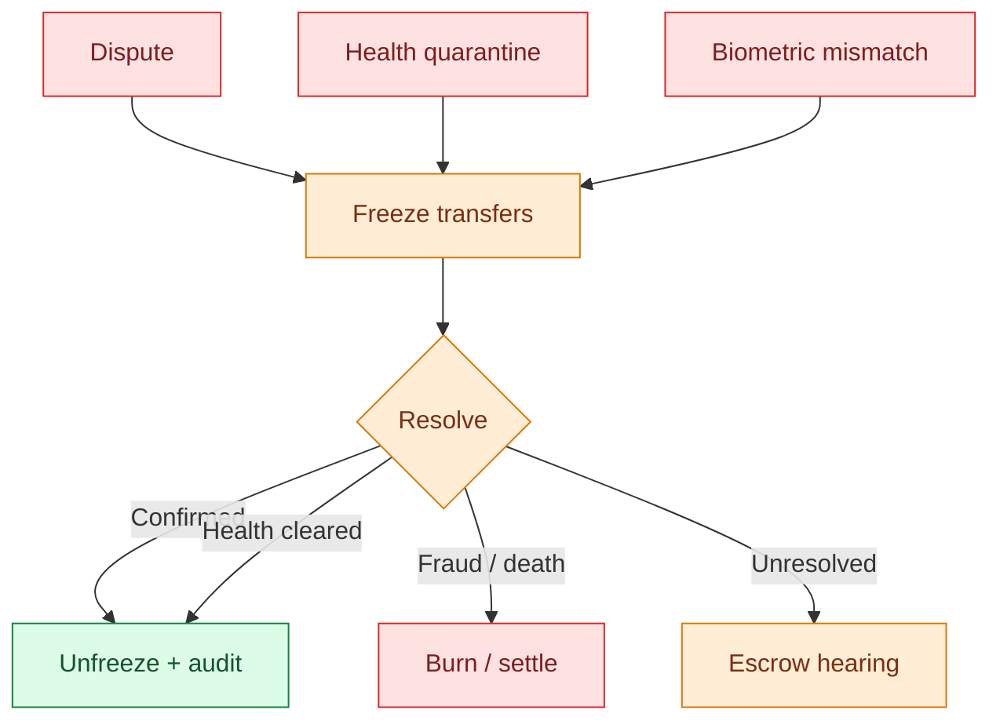

# End-to-end architecture & flows


This chapter is the **visual spine** of the whitepaper — follow the coloured layers from farm to market.


## Layer map

## Happy path

## When something goes wrong

## Readiness checklist

| Capability | Ready when… |
| --- | --- |
| Capture | ≥1 certified edge app writing promotes |
| Legal ID | Registry live with ACL + audit log |
| Health | Protocol v0.1 + attestor network |
| Token | Mint gate enforced in code + docs |
| Grid | Daily feed with methodology note |
| Market | Stage-1 PSX info product **or** private benchmark used by a bank |
