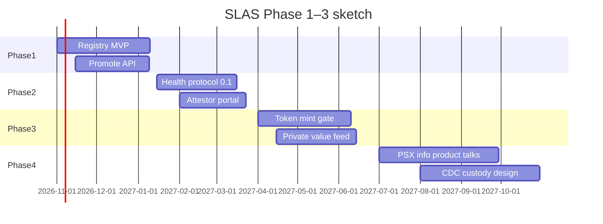

# How to achieve it: roadmap


**Build sequence** for an independent convenor — not an institutional mandate.


This chapter turns the architecture into phases you can actually run.

## Phase 0 — Paper & coalition (4–8 weeks)

**Outcomes**

- Freeze SLAS vocabulary and chapter claims (this GitBook)
- Choose province + species (e.g. Sindh cattle **or** Punjab broiler batches)
- Choose integration model (**B — dual-rail** recommended)
- Draft one-pagers for registry company counsel, one edge platform, one bank, one insurer

**Exit criteria:** signed interest letters (non-binding) from ≥3 parties.

## Phase 1 — Identity spine (8–16 weeks)

**Build**

- Registry company incorporation + data policy
- Promote API from Animal Passport-class edge (+ PAITS ID mapping where available)
- Owner KYC lite + dispute workflow
- Bank read API (eligibility only)

**Exit criteria:** 1,000+ promoted live IDs (or equivalent poultry batches) with <2% unresolved disputes.

## Phase 2 — Health feeds (parallelizable, 8–14 weeks)

**Build**

- Publish `SLAS-HEALTH-0.1` schema
- Onboard attestors (vets / labs)
- Daily job that writes grades to registry pointers
- Freeze hooks for quarantine

**Exit criteria:** ≥70% of pilot inventory has a non-expired grade.

## Phase 3 — Controlled tokenization (10–16 weeks)

**Build**

- Legal memo on instrument type under PVARA perimeter
- Mint gate implementation (identity + health + pledge graph)
- Investor disclosures + Shariah review track
- Optional internal transfer register

**Exit criteria:** successful test mint/burn cycle on **sandbox** assets with zero double-count incidents.

## Phase 4 — Grid & market visibility (12–20 weeks)

**Build**

- Private daily value feed for pilot region
- Publish `pct_verified_inventory`
- Bank collateral simulation
- Conversations with PSX for **Stage-1 information product** (not rushed listing)
- CDC custody design workshop (phased)

**Exit criteria:** 60 consecutive publish days; at least one financial institution consumes the feed in a pilot credit or insurance process.

## RACI (starter)

| Workstream | Responsible | Accountable | Consulted | Informed |
| --- | --- | --- | --- | --- |
| Registry company | Incorporators / ops lead | Board of registry co. | Counsel, edge apps | Farmers |
| Field capture | Edge platform | Registry co. | PAITS/PITB | MoU parties |
| Health protocol | Standards working group | Protocol chair | Vets, MoH, livestock dept | Issuers |
| Token rules | Issuer + counsel | Issuer board | PVARA perimeter advisors | Investors |
| Value feed | Grid methodology lead | Grid steward | Mandi agents, banks | PSX (when engaged) |
| Custody | CDC design counterparts | Registry / issuer jointly | SECP-related advisors | Token holders |

## Independent convenor model

Because this paper is **not** an institutional project, achievement depends on a **light convenor**:

1. Publish the blueprint (this GitBook + PDF)
2. Host a closed workshop with edge, bank, insurer, counsel
3. Spin the registry company as a neutral utility
4. Keep vendors interchangeable via schemas and certification

## Budget & talent sketch (order-of-magnitude)

| Bucket | Notes |
| --- | --- |
| Legal / company setup | Incorporation, data protection, MoUs |
| Engineering | Registry, promote API, attestor portal, feed publisher |
| Field ops | Onboarding, verification drives, dispute desk |
| Clinical protocol | Standards writing, training, audits |
| Market design | Methodology, disclosures, PSX/CDC conversations |

Exact PKR figures should be built bottom-up for the chosen province; do not fake precision in v1.
