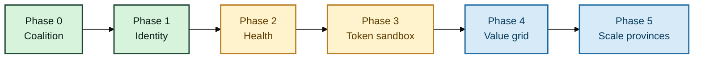
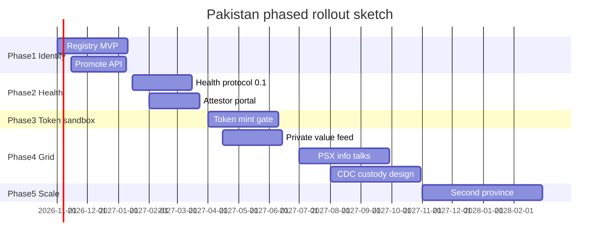

# How to achieve it: roadmap


**Do not flip every switch on day one.** Pakistan should execute this as a **phased national rollout** — one province, one species, one layer at a time — then expand only when exit criteria pass.



This is a build sequence for practitioners and policymakers — not an institutional mandate. The stack is designed for **pilot → prove → scale**, never “big bang.”


## Golden rule for Pakistan

| Wrong approach | Right approach |
| --- | --- |
| Launch tokens + PSX listing + national registry together | Start with **identity + registry** in one district |
| Mandate every farmer overnight | Onboard through aggregators / progressive farms first |
| Treat PSX/CDC as week-one requirements | Keep them for **later phases** after feeds are honest |
| Copy a foreign “full stack” and hope | Use local rails (PAITS, Passport-class apps, PVARA perimeter) in order |

## Phase 0 — Paper & coalition (4–8 weeks)

**Purpose:** agree what “done” means before writing code.

**Outcomes**

- Freeze SLAS vocabulary (this whitepaper)
- Choose **one province + one species** (e.g. Sindh cattle **or** Punjab broilers — not both)
- Choose integration model (**B — dual-rail** recommended)
- Draft one-pagers for registry counsel, one edge platform, one bank, one insurer

**Exit criteria:** non-binding interest letters from ≥3 parties.


If Phase 0 cannot name a single pilot geography, **stop**. National ambition without a yard to test in becomes theatre.


## Phase 1 — Identity spine only (8–16 weeks)

**Purpose:** prove animals can be promoted into a legal registry — nothing else.

**Build**

- Registry company incorporation + data policy
- Promote API from Animal Passport-class edge (+ PAITS mapping where available)
- Owner KYC lite + dispute workflow
- Bank **read-only** eligibility API

**Exit criteria:** 1,000+ promoted live IDs (or equivalent poultry batches) with &lt;2% unresolved disputes.

**Still off-limits in Phase 1:** retail tokens, PSX listings, national mandates.

## Phase 2 — Health feeds (8–14 weeks, after identity works)

**Purpose:** attach portable grades to registry IDs.

**Build**

- Publish `SLAS-HEALTH-0.1`
- Onboard attestors (vets / labs)
- Daily grade jobs + quarantine freeze hooks

**Exit criteria:** ≥70% of pilot inventory has a non-expired grade.

## Phase 3 — Controlled tokenization sandbox (10–16 weeks)

**Purpose:** test mint gates on **sandbox** assets — not a public market launch.

**Build**

- Legal memo under PVARA perimeter
- Mint gate (identity + health + pledge graph)
- Disclosures + Shariah review track
- Optional internal transfer register

**Exit criteria:** clean test mint/burn with zero double-count incidents.


Phase 3 is a **sandbox**. Public retail products wait until phases 1–2 are boringly reliable.


## Phase 4 — Value grid & market visibility (12–20 weeks)

**Purpose:** publish honest daily prices for the pilot region; talk to PSX as an **information product** first.

**Build**

- Private daily value feed + `pct_verified_inventory`
- Bank collateral simulation
- PSX Stage-1 information-product conversations (not rushed listing)
- CDC custody design workshop (still phased)

**Exit criteria:** 60 consecutive publish days; ≥1 financial institution consumes the feed in a pilot credit/insurance process.

## Phase 5 — Scale across provinces (only after proof)

**Purpose:** copy what worked — do not redesign under pressure.

**Rules for scale**

1. Second province only after Phase 4 exit criteria hold for one full quarter
2. Add poultry **or** cattle second — not both in the same wave
3. Keep vendor interchangeability (certify edge apps; don’t lock the nation to one)
4. Expand PSX/CDC roles only when verified inventory % stays high

## Why phases protect Pakistan

| Risk of “all at once” | What phasing prevents |
| --- | --- |
| Fake inventory minted as tokens | Mint only after identity + health gates work |
| Farmer distrust | Start voluntary / aggregator-led, prove benefit |
| Exchange brand damage | PSX sees clean feeds before any listing talk |
| Policy whiplash | Each phase has exit criteria before the next unlocks |

## RACI (starter)

| Workstream | Responsible | Accountable | Consulted | Informed |
| --- | --- | --- | --- | --- |
| Registry company | Incorporators / ops lead | Board of registry co. | Counsel, edge apps | Farmers |
| Field capture | Edge platform | Registry co. | PAITS/PITB | MoU parties |
| Health protocol | Standards working group | Protocol chair | Vets, MoH, livestock dept | Issuers |
| Token rules | Issuer + counsel | Issuer board | PVARA perimeter advisors | Investors |
| Value feed | Grid methodology lead | Grid steward | Mandi agents, banks | PSX (when engaged) |
| Custody | CDC design counterparts | Registry / issuer jointly | SECP-related advisors | Token holders |

## Independent convenor model

1. Publish the blueprint (site + PDF)
2. Host a closed Phase-0 workshop (edge, bank, insurer, counsel)
3. Spin the registry company as a neutral utility for the pilot
4. Unlock Phase 2 only when Phase 1 metrics pass — in public, with numbers

Exact PKR budgets should be built bottom-up for the chosen district; do not fake precision in v1.
