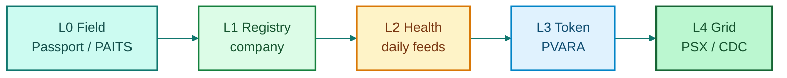

# The Smart Livestock Asset Stack

### From Biometric Passport to Exchange Rails in Pakistan


**Independent research by Ammar Jamshed** — personal work, no bank / exchange / ministry / vendor affiliation or endorsement.



**Live site:** [livestockmon.gitbook.io/smart-livestock-asset-stack](https://livestockmon.gitbook.io/smart-livestock-asset-stack/) · Use page Actions → **Export as PDF** when enabled.


| | |
| --- | --- |
| **Author** | Ammar Jamshed |
| **Status** | Independent research note (v1.0) |
| **Focus** | Pakistan livestock & poultry market infrastructure |
| **Stack name** | **SLAS** — Smart Livestock Asset Stack |

---

## What this paper proposes

A **smart process** that turns living animals and poultry flocks into **bankable, attestable, and market-visible assets** in five coloured layers:

| Layer | Colour cue | Job |
| --- | --- | --- |
| **L0 Field** | Teal | Animal Passport / PAITS capture |
| **L1 Registry** | Green | Legal company system of record |
| **L2 Health** | Amber | Certified daily assessment feeds |
| **L3 Token** | Sky | PVARA-aligned mint gates |
| **L4 Grid** | Forest | Daily value feeds → PSX / CDC |

## Pick your path

| If you want… | Go here |
| --- | --- |
| The one-page claim | [Executive summary](01-executive-summary.md) |
| Why animals stay unbankable | [The problem](02-the-problem.md) |
| Field apps (Animal Passport) | [Field identity](03-field-identity.md) |
| Full flow diagrams | [Architecture & flows](08-architecture.md) |
| Build sequence | [How to achieve it](09-roadmap.md) |
| Author + independence | [About](about-the-author.md) · [Disclaimer](independence-and-disclaimer.md) |
| **PDF** | [Download PDF](download-pdf.md) |


Named institutions (PSX, CDC, PVARA, AKUH, MoH, Animal Passport, PAITS) appear only as **proposed counterparties or public references** — not as partners who have signed this paper.


## Suggested citation

> Jamshed, A. (2026). *The Smart Livestock Asset Stack: From Biometric Passport to Exchange Rails in Pakistan* (Independent whitepaper, v1.0).
