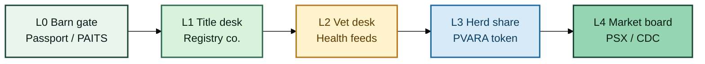

# The Smart Livestock Asset Stack

### From the barn gate to the exchange board


**Farm → Registry → Health → Token → Market grid**\
Independent research by **Ammar Jamshed** — no bank, exchange, ministry, or vendor allegiance.



**Live:** [livestockmon.gitbook.io/smart-livestock-asset-stack](https://livestockmon.gitbook.io/smart-livestock-asset-stack/) · Page Actions → **Export as PDF**


| Farm metaphor | Stack layer | Job |
| --- | --- | --- |
| **Ear tag / muzzle scan** | L0 Field | Animal Passport / PAITS capture |
| **Title deed for the animal** | L1 Registry | Legal company system of record |
| **Vet desk grade** | L2 Health | Certified daily assessment feeds |
| **Share of the herd / flock** | L3 Token | PVARA-aligned mint gates |
| **Mandi board → national board** | L4 Grid | Daily value feeds → PSX / CDC |

## Walk the farm

| If you want… | Open this gate |
| --- | --- |
| The one-page claim | [Executive summary](01-executive-summary.md) |
| Why animals stay off-book | [The problem](02-the-problem.md) |
| Field apps (Animal Passport) | [Field identity](03-field-identity.md) |
| Vet / health rail | [Health assessment](05-health-assessment.md) |
| Full yard map | [Architecture & flows](08-architecture.md) |
| Build sequence | [How to achieve it](09-roadmap.md) |
| Author + independence | [About](about-the-author.md) · [Disclaimer](independence-and-disclaimer.md) |
| **PDF** | [Download PDF](download-pdf.md) |


Institutions named in this paper (PSX, CDC, PVARA, AKUH, MoH, Animal Passport, PAITS) are **proposed counterparties or public references** — not signed partners.


## Suggested citation

> Jamshed, A. (2026). *The Smart Livestock Asset Stack: From Biometric Passport to Exchange Rails in Pakistan* (Independent whitepaper, v1.0).
