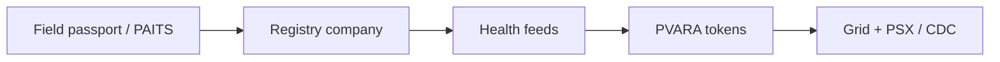

# The Smart Livestock Asset Stack

### From Biometric Passport to Exchange Rails in Pakistan

**An independent whitepaper on digitizing, certifying, tokenizing, and pricing livestock & poultry assets**

| | |
| --- | --- |
| **Author** | Ammar Jamshed |
| **Status** | Independent research note (v1.0) |
| **Stance** | Personal work — no institutional affiliation, endorsement, or mandate |
| **Focus** | Pakistan livestock & poultry market infrastructure |

---

## What this paper proposes

A **smart process** that turns living animals and poultry flocks into **bankable, attestable, and market-visible assets** by stacking five layers:

1. **Field identity** — platforms such as Animal Passport (biometric muzzle ID) and PAITS (national traceability)
2. **Registry company** — legal system of record (not informal “access”)
3. **Health assessment feeds** — daily clinical / veterinary attestations (proposed rails with partners such as AKUH standards and Ministry of Health / livestock ministries)
4. **PVARA-aligned tokenization** — mint only when identity + health pass
5. **Livestock & poultry grid** — daily value feeds with PSX visibility and phased CDC custody

## How to read this GitBook

| If you want… | Start here |
| --- | --- |
| The one-page claim | [Executive summary](01-executive-summary.md) |
| Diagrams of the full flow | [Architecture & flows](08-architecture.md) |
| A practical build path | [How to achieve it](09-roadmap.md) |
| Who wrote this & independence | [About the author](about-the-author.md) · [Disclaimer](independence-and-disclaimer.md) |
| **PDF download** | [Download PDF](download-pdf.md) |

## Independence (read this first)

This whitepaper is published by **Ammar Jamshed as an independent author**. It is **not** issued by, commissioned by, or endorsed by any bank, exchange, hospital, ministry, regulator, university, or technology vendor — including any current or former employer. Named institutions appear only as **proposed counterparties or public reference points** in a market-design discussion. See [Independence & disclaimer](independence-and-disclaimer.md).

## Suggested citation

> Jamshed, A. (2026). *The Smart Livestock Asset Stack: From Biometric Passport to Exchange Rails in Pakistan* (Independent whitepaper, v1.0).
